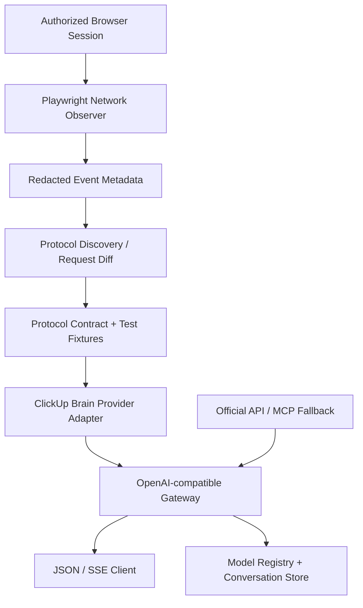

# 03 — Kiến trúc Web → API và lộ trình POC

> **Trạng thái:** research-first + adapter-ready. Được lập kế hoạch trên cơ sở người thực hiện cho biết có ủy quyền. Chưa có schema request hay endpoint ClickUp được đo thực tế.

## Kiến trúc đích



Tách `capture` (quan sát), `analysis` (rút schema), `transport` (thực thi protocol), `adapter` (dịch request/response), `gateway` (OpenAI-like API). Không nên viết gateway phụ thuộc trực tiếp CSS selector hay raw cookie.

## Các adapter

| Adapter | Hoạt động | Ưu | Nhược |
|---|---|---|---|
| `BrowserUIAdapter` | Playwright thao tác UI, lấy kết quả DOM, thay model qua UI | Không cần giả định wire protocol; dùng với browser được ủy quyền | CPU cao, selector dễ thay đổi, streaming DOM chỉ gần đúng |
| `BrowserNetworkAdapter` | Browser được ủy quyền điều khiển request/response, xử lý event stream | Có context của session thực | Cần hiểu request lifecycle/permission, browser cost |
| `ProtocolAdapter` | HTTP/WS client theo **schema được xác nhận** và trong scope được cấp | Nhanh, dễ autoscale và stream | Dễ gãy theo version, auth/session phức tạp |
| `OfficialToolAdapter` | ClickUp API/MCP + external LLM | Tài liệu chính thức, rõ permission | Không phải Brain² native chat |

**Không hardcode endpoint từ ảnh**. Quyết định adapter dựa trên capture thực nghiệm và điều kiện được phép.

## Cấu trúc dự kiến

```text
app/
  api.py                 # GET /v1/models, POST /v1/chat/completions
  schemas.py             # OpenAI-style messages/stream, error normalization
  registry.py            # dynamic label -> request model mapping
  providers/
    base.py              # Adapter Protocol / Abstract Base
    browser_ui.py        # DOM-driven, independently testable
    brain_protocol.py    # implementation after trace + contract
    clickup_mcp.py       # official alternative
  sessions/
    store.py             # per-user/per-workspace conversation mapping
  transport/
    http.py
    websocket.py
    stream_decoder.py
  security/
    auth.py              # gateway auth, token vault; no secrets in git
tools/
  trace_browser.py       # passive redacted network observer
  summarize_trace.py     # aggregate endpoint/transport metadata
tests/
  ...                    # mock contracts, fixtures
```

## Interface hợp đồng

```python
from typing import AsyncIterator, Protocol

class BrainAdapter(Protocol):
    async def list_models(self) -> list[dict]: ...
    async def send(self, *, conversation_id: str | None, model: str,
                   messages: list[dict]) -> dict: ...
    async def stream(self, *, conversation_id: str | None, model: str,
                     messages: list[dict]) -> AsyncIterator[dict]: ...
    async def close(self) -> None: ...
```

Trường bắt buộc trong kết quả normalized: `content`, `provider_conversation_id` (nếu có), `provider_response_id` (nếu có), `resolved_model` (nếu được upstream báo), `finish_reason` (nếu có), `usage` (nếu có). Không tạo fake usage hay giả định model đã thực thi.

## Gateway dự kiến

- `GET /healthz`: liveness; không có nghĩa upstream hoạt động.
- `GET /readyz`: có adapter và secret session vault sẵn sàng.
- `GET /v1/models`: model thật sự khả dụng trong adapter/Workspace được kết nối, không phải danh sách hardcode.
- `POST /v1/chat/completions`: JSON hoặc SSE với `model`, `messages`, optional `conversation_id`. Trả lỗi có phân loại nếu model không hỗ trợ.
- `DELETE /v1/conversations/{id}`: giải phóng local state, chỉ xóa upstream nếu được phép/hợp đồng hỗ trợ.

```json
{
  "model": "brain-ui:claude-opus-5.5",
  "messages": [{"role": "user", "content": "Say hello"}],
  "stream": true,
  "metadata": {"conversation_id": "local-conversation-id"}
}
```

Ví dụ JSON chỉ là **đề xuất alias của gateway**, không phải ClickUp model ID hoặc endpoint.

## Dòng trạng thái hội thoại

```text
NEW -> SESSION_READY -> SENDING -> STREAMING -> COMPLETED
                                      |             |
                                      v             v
                                    ERROR        CONTINUE
                                                     |
                                          MODEL_SWITCH_REQUESTED
                                                     |
                                               next SENDING
```

Persist `local_conversation_id`, `remote_conversation_id`, `selected_ui_model`, `resolved_model` (nếu known), `message_history`, `scope`. Lock per conversation để không trộn parallel turns. Handle 401/403/409/429/5xx và stream disconnect rõ ràng.

## Các phase kỹ thuật

### Phase 1 — Passive protocol discovery

1. Chạy `tools/trace_browser.py` bằng phiên browser riêng; không ghi secret/raw prompt.
2. Thực hiện thủ công theo thứ tự: load Brain -> Max first turn -> Max continuation -> new chat -> Claude/GPT/Gemini first turn -> mid-chat switch.
3. Đọc `artifacts/network_events.jsonl`, dùng `tools/summarize_trace.py` nhóm HTTP method / path / content-type / latency.
4. Khi tìm được nhóm candidate, inspect HAR/DevTools **nội bộ** trong phạm vi nghiên cứu để xác định field names, state references và event protocol. Không commit HAR thô.

### Phase 2 — Protocol contract

- Định nghĩa `request_schema` / `response_schema` và mock fixture **đã mask**.
- Xác nhận model switch thay đổi field nào, có requires conversation/session reset không.
- Xác nhận `stream=` có thực sự SSE/WS hay chunked response khác.
- Ghi `confidence`: observed / inferred / not-confirmed.

### Phase 3 — Adapter + Gateway

- Chọn BrowserUI / BrowserNetwork / ProtocolAdapter theo bằng chứng và scope.
- Implement JSON response trước; rồi token/event streaming.
- Thêm multi-model registry và per-conversation mutex.
- Rate limiting client-side để tránh hỏng session; concurrency tests và retry/backoff theo allowance.

### Phase 4 — Deployment

- Container Docker và secret store; browser profile persistence chỉ trên encrypted volume.
- Không sử dụng GitHub Actions như nơi lưu cookie/browser profile.
- Cloud deployment chỉ khi phiên đăng nhập và điều kiện quyền truy cập cho phép.

## Tiêu chí đạt

1. Có trace quan sát request thực tế của ít nhất 2 model mà không ghi bí mật vào repo.
2. Test first turn / continued turn / new conversation / model switch.
3. Câu trả lời không bị trộn từ các request đồng thời.
4. Chứng minh transport và end-of-stream dựa trên bằng chứng; không mô phỏng SSE nếu upstream không stream.
5. Gateway báo model thực tế (nếu xác minh được) hoặc `unknown`; không ngụy tạo mapping.
6. Một trạng thái `blocked-by-permission` phải được xử lý rõ, không tìm cách qua cơ chế hạn chế truy cập.

## Quy tắc nghiên cứu

Không có lệnh “cấm làm Web → API” ở tầng kiến trúc. Điều kiện thực thi là **scope ủy quyền** và thiết kế bảo vệ secrets. Các service limits/rate limits thực tế vẫn tồn tại, không phải điều kiện có thể xóa bằng commit.
